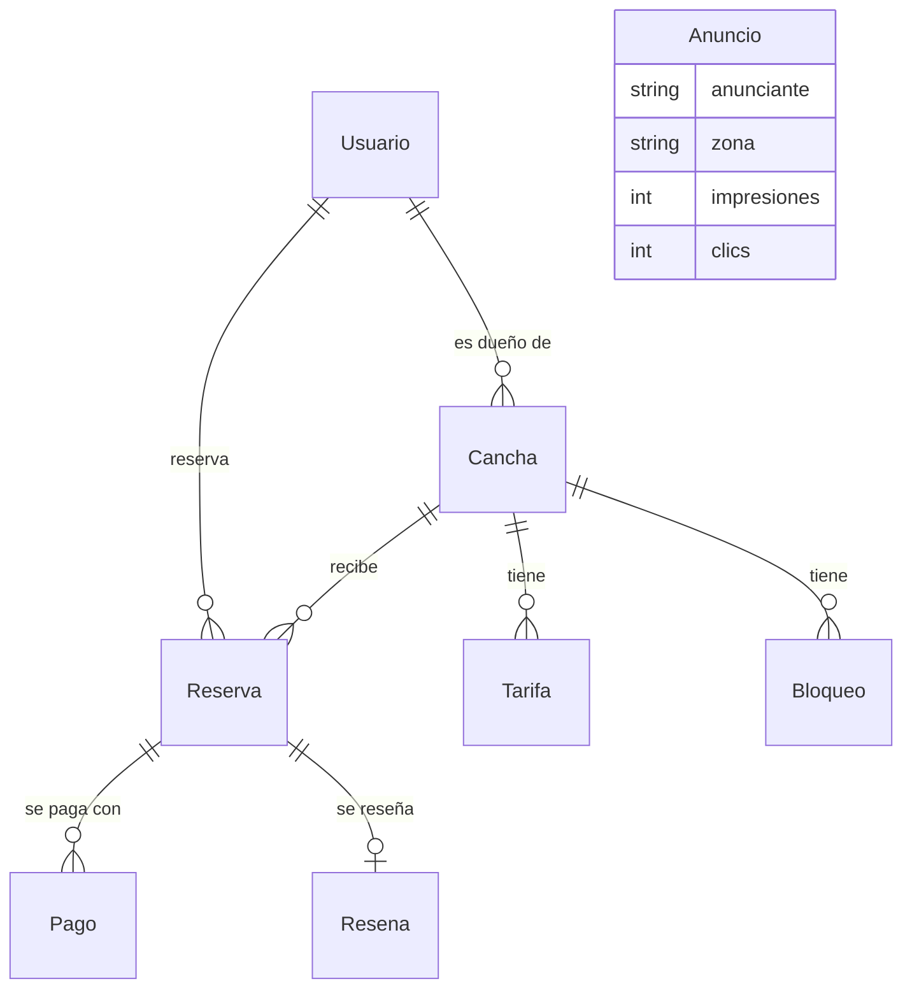

# tukanchitape · Canchitas Cusco (repositorio Tuchanchitap)

Plataforma para reservar **canchitas de fulbito** del círculo local de Cusco. El jugador ve las horas libres en un mapa, separa su hora y paga el adelanto por **Yape o Plin**. El dueño maneja su calendario, sus tarifas y sus bloqueos, y aprueba los comprobantes. La administración gestiona usuarios, canchas, reservas, reseñas y **anuncios discretos de negocios del barrio**.

> Proyecto Integrador · Unidad III · *Plataformas para el desarrollo de aplicaciones* · Ingeniería de Sistemas, Universidad Andina del Cusco.
> **Costo cero:** nada de lo que usa pide tarjeta.

## Equipo

| Integrante | Módulos |
| --- | --- |
| Aguirre Bravo, Edson Francisco Lino | Usuarios y autenticación · Canchas · Despliegue |
| Estudiante 2 _(por completar)_ | Reservas · Tarifas y bloqueos |
| Estudiante 3 _(por completar)_ | Pagos Yape/Plin · Reseñas · Panel admin |
| Estudiante 4 _(por completar)_ | Frontend React · Pruebas (Jest, Postman) |

**Documentos del Hito 1** (en `docs/`): propuesta (`Propuesta_Proyecto.docx`), evidencias (`Hito1_Evidencias.docx`), avance (`AVANCE.md`), diagramas de arquitectura y entidad-relación (`docs/diagramas/`) y pantallas del diseño (`docs/pantallas/`). En esta versión, el pago en línea con Mercado Pago del Hito 1 se reemplazó por Yape/Plin manual, para mantener el **costo cero**.

---

## Contenido

1. [Qué hace](#qué-hace)
2. [Stack y decisiones de costo cero](#stack-y-decisiones-de-costo-cero)
3. [Arquitectura](#arquitectura)
4. [Modelo de datos](#modelo-de-datos)
5. [Reglas de negocio](#reglas-de-negocio-probadas-en-jest)
6. [Instalación y ejecución local](#instalación-y-ejecución-local)
7. [Variables de entorno](#variables-de-entorno)
8. [Usuarios de prueba](#usuarios-de-prueba)
9. [API: endpoints principales](#api-endpoints-principales)
10. [Pruebas, cobertura y Postman](#pruebas-cobertura-y-postman)
11. [Anuncios sin saturar](#anuncios-sin-saturar)
12. [Despliegue (Supabase + Render)](#despliegue-supabase--render)
13. [Hoja de ruta](#hoja-de-ruta)

---

## Qué hace

**Jugador**
- Mapa de canchas (Leaflet + OpenStreetMap) con filtros por tipo, formato, techada, con luz y precio máximo, más la opción "cerca de mí" (ubicación del navegador). El listado viene paginado.
- Ficha de la cancha: horas libres del día con su precio, tarifas, reseñas, botón **Cómo llegar** (enlace gratuito de Google Maps) y **WhatsApp** del dueño (`wa.me` con el texto ya escrito).
- Reserva: separa la hora **15 minutos**. Luego sube la foto del comprobante de Yape/Plin con el número de operación.
- **Mis reservas:** estado de cada reserva, cuenta regresiva para pagar, cancelación (con aviso si pierde el adelanto) y reseña después de jugar.

**Dueño** (`/panel`, todo en ventanas de diálogo)
- CRUD de sus canchas con ubicación en el mapa (búsqueda por dirección con Nominatim), fotos y QR de Yape/Plin, y botón de publicar o despublicar.
- Tarifas por franja (por ejemplo, lunes a viernes de 18 a 23 a S/ 70) y bloqueos por lluvia o mantenimiento.
- Calendario semanal con WhatsApp a cada jugador, y la bandeja de pagos para aprobar o rechazar comprobantes.

**Admin** (`/admin`)
- Resumen con los números de la plataforma.
- CRUD de usuarios: crear dueños, cambiar roles y desactivar cuentas.
- Todas las canchas (con reasignación de dueño), reservas, pagos, moderación de reseñas y CRUD de anuncios con impresiones, clics y tasa de clics.

Estados en todas las pantallas: **cargando** (esqueletos con brillo), **error** (con botón para reintentar), **vacío** (con una acción sugerida) y **éxito** (avisos tipo toast).

### Diseño "Noche de estadio"

Elegido entre 6 propuestas (láminas en `docs/diseno/`). Una cancha de noche bajo los reflectores: verde noche, fotos reales de fondo, tarjetas de vidrio y verde lima neón para lo que se toca. Letra *Bebas Neue* en los títulos y *Nunito* para leer.

- **Portada:** carrusel de fotos que "respiran" (zoom lento), reflectores que se encienden al cargar, título que se escribe solo y contador animado de canchas.
- **Tarjetas:** foto, insignia "Libre hoy HH:00", inclinación 3D con el mouse y **horas libres de hoy** como botones para reservar en dos toques.
- **SweetAlert2 en todas las acciones:** confirmar reserva (con resumen y cargando), celebración con **confeti** y "Avisar al equipo" por WhatsApp, cancelar (avisa si pierde el adelanto), aprobar o rechazar pagos (motivo dentro de la alerta), borrar en los paneles y avisos tipo toast.
- **Mis reservas:** anillo de cuenta regresiva con mensajes tranquilos ("tranqui, aún tienes tiempo").
- **Accesibilidad:** con "reducir movimiento" activado en el sistema, las animaciones se apagan.

### Imágenes del sitio (administrables)

En **Admin → Imágenes del sitio** se cambian sin tocar código:
- **Portada:** fotos del carrusel del inicio.
- **Ingreso:** fondo de ingresar y crear cuenta.
- **Cancha sin foto:** imagen que se usa cuando una cancha aún no subió fotos.

Cada imagen se agrega **subiendo y recortando** (Cropper.js, con la proporción de su lugar) o pegando una URL. Se puede **ordenar, pausar o activar, editar y borrar**. La API impide dejar un lugar sin imágenes. La semilla trae fotos libres de Unsplash con su crédito (Paul Lora, Tahamie Farooqui, Jose G. Ortega Castro e Izuddin Helmi Adnan), para reemplazarlas por fotos reales.

## Stack y decisiones de costo cero

| Capa | Tecnología |
| --- | --- |
| API | Node.js 22, Express 5, Prisma 6 + PostgreSQL, Zod, jsonwebtoken + bcryptjs, helmet, cors, express-rate-limit, multer, swagger-ui-express |
| Pruebas | Jest + Supertest (base en memoria que imita a Prisma) |
| Frontend | React 19 + Vite (JavaScript), React Router 7, Axios con interceptor del JWT, Leaflet + react-leaflet, SweetAlert2, canvas-confetti, Cropper.js |
| Datos | PostgreSQL en **Supabase** (plan gratis) y Supabase Storage para las fotos |
| Despliegue | **Render** (plan gratis) con `render.yaml`, y GitHub Actions como CI |

| Necesidad | Opción de pago descartada | Opción gratis usada |
| --- | --- | --- |
| Mapa | Google Maps API | Leaflet + teselas de OpenStreetMap (sin clave) oscurecidas con un filtro CSS |
| Fotos de fondo | Bancos de imágenes de pago | Fotos libres de Unsplash (con crédito), reemplazables desde el panel |
| Buscar dirección | Google Places | Nominatim (1 consulta/s, solo al registrar una cancha) |
| Cómo llegar | Directions API | Enlace `https://www.google.com/maps/dir/?api=1&destination=LAT,LNG` |
| Cobrar adelanto | Pasarela con comisión | Yape/Plin manual: QR del dueño, foto del comprobante y aprobación |
| Avisos | WhatsApp Business API / SMS | Enlaces `wa.me` con el texto listo |
| Ingresos | Google AdSense | Anuncios directos de negocios del barrio, gestionados en el panel |

## Arquitectura

```
backend/src
├── rutas/          solo URL + middleware (auth, permisos, validación)
├── controladores/  traducen HTTP ↔ servicio (delgados)
├── validadores/    esquemas Zod puros
├── servicios/      reglas de negocio; lanzan ErrorNegocio(mensaje, status)
├── db/             Prisma (PostgreSQL) o base en memoria (pruebas / modo demo)
├── middleware/     auth JWT + roles, validar, subida de imágenes, errores
├── lib/            errores, respuesta, horario Cusco (UTC-5), geo, almacén
└── docs/           especificación OpenAPI (Swagger en /docs)
```

- **Respuestas uniformes:** `{ ok: true, data }` o `{ ok: false, error, campos }`.
- **Códigos HTTP:** 200, 201, 204, 400 (JSON roto, falta la imagen), 401 (sin sesión), 403 (sin permiso), 404, 409 (choque de horario, duplicado), 422 (validación o regla de tiempo) y 500.
- **Modo demo:** si `DATABASE_URL` está vacío, la API arranca con una base **en memoria** cargada con la semilla. Así el proyecto corre sin cuentas externas. Los datos se pierden al reiniciar.

```
frontend/src
├── api/cliente.js   Axios: baseURL, token Bearer, errores normalizados
├── contexto/        sesión (JWT en localStorage)
├── componentes/     Mapa, Dialogo, Anuncio, FormCancha, Estado (cargando/error/vacío)…
├── paginas/         Inicio, Cancha, Acceso, MisReservas, PanelDueno, PanelAdmin
└── util/            formato (hora de Cusco, soles, wa.me), useCarga, nominatim
```

## Modelo de datos

9 entidades relacionadas (`backend/prisma/schema.prisma`), con 3 migraciones en `backend/prisma/migrations`.



- **Usuario:** `rol` puede ser JUGADOR, DUENO o ADMIN.
- **Cancha:** tipo SINTETICO/LOSA/GRASS, formato 5/7/11, techada, con luz, lat/lng, fotos, QR y publicada.
- **Tarifa:** día de la semana, hora de inicio y de fin, y precio por hora.
- **Bloqueo:** inicio, fin y motivo (LLUVIA, MANTENIMIENTO…).
- **Reserva:** total, adelanto, estado PENDIENTE_PAGO/CONFIRMADA/CANCELADA/EXPIRADA/JUGADA, `expiraEn` y `adelantoPerdido`.
- **Pago:** YAPE/PLIN, número de operación (único) y foto.
- **Resena:** una por reserva.
- **Anuncio:** vigencia y estadísticas de impresiones y clics.
- **ImagenSitio:** lugar (PORTADA/INGRESO/CANCHA_SIN_FOTO), URL, crédito, orden y activa.

## Reglas de negocio (probadas en Jest)

| # | Regla | Dónde | Prueba |
| --- | --- | --- | --- |
| 1 | No se reserva una hora que se cruza con otra reserva activa o con un bloqueo → **409**. Se revisa en una transacción *Serializable*: si dos jugadores reservan a la vez, uno recibe 409. | `servicios/reservas.js` | `pruebas/reservas.spec.js` |
| 2 | La reserva nace PENDIENTE_PAGO y separa la hora 15 min (`MINUTOS_SEPARACION`). Sin comprobante, **expira** y la hora se libera. | `servicios/mantenimiento.js` | `reservas.spec.js`, `horarios.spec.js` |
| 3 | El precio sale de las tarifas por franja (día/noche, fin de semana). Si el navegador manda el precio → **422**. | `servicios/precios.js`, `validadores/reservas.js` | `horarios.spec.js`, `reservas.spec.js` |
| 4 | Solo el dueño de la cancha (o ADMIN) la edita, ve sus reservas y aprueba pagos → **403**. | `servicios/canchas.js` (`asegurarDueno`) | `canchas.spec.js`, `pagos.spec.js` |
| 5 | Si el jugador cancela con menos de `HORAS_CANCELACION` (6 h), pierde el adelanto. Si cancela el dueño, nunca se pierde. | `servicios/reservas.js` | `reservas.spec.js` |
| 6 | Un número de operación de Yape/Plin no se acepta dos veces → **409** (además de `@@unique` en la base). | `servicios/pagos.js` | `pagos.spec.js` |
| 7 | Solo reseña quien jugó esa reserva, y una sola vez por reserva. | `servicios/resenas.js` | `pagos.spec.js` |
| 8 | No se reserva en el pasado, fuera del horario de la cancha ni a más de 30 días → **422**. | `servicios/reservas.js` | `reservas.spec.js` |

Además: máximo 3 reservas esperando pago por jugador; tarifas que no se cruzan; no se bloquea encima de reservas activas; no se borra una cancha con historial (se despublica); el admin no puede quitarse su propio rol.

## Instalación y ejecución local

Requisitos: **Node.js 22 o superior** y Git. PostgreSQL es opcional: sin él, la API corre en modo demo en memoria.

En PowerShell, un comando a la vez:

```powershell
git clone https://github.com/020200141d-coder/Tuchanchitap.git canchitas-cusco
```

```powershell
cd canchitas-cusco\backend
```

```powershell
npm install
```

```powershell
Copy-Item .env.example .env
```

```powershell
npm run dev
```

La API queda en http://localhost:3000, y Swagger en http://localhost:3000/docs. En otra terminal:

```powershell
cd canchitas-cusco\frontend
```

```powershell
npm install
```

```powershell
npm run dev
```

Abre http://localhost:5173. Vite redirige `/api` y `/uploads` al backend.

**Con PostgreSQL (Supabase o local):** llena `DATABASE_URL` y `DIRECT_URL` en `backend/.env` y luego corre:

```powershell
npm run migrar:produccion
```

```powershell
npm run semilla
```

## Variables de entorno

`backend/.env.example` (copia como `.env`; el `.env` está en `.gitignore`):

| Variable | Para qué |
| --- | --- |
| `PORT` | Puerto de la API (3000) |
| `URL_PUBLICA` | URL de la API, para armar los enlaces de las fotos |
| `FRONTEND_URL` | Orígenes permitidos por CORS (separados por coma) |
| `DATABASE_URL` / `DIRECT_URL` | PostgreSQL (Supabase: pooler y conexión directa). Vacío = modo demo |
| `JWT_SECRETO` / `JWT_EXPIRA` | Firma y duración del token (obligatorio en producción) |
| `MINUTOS_SEPARACION`, `HORAS_CANCELACION`, `PORCENTAJE_ADELANTO`, `HORAS_MAXIMAS_RESERVA`, `DIAS_ANTICIPACION` | Reglas de negocio configurables |
| `SEMILLA_PASSWORD` | Contraseña de los usuarios de prueba (opcional) |
| `SUPABASE_URL`, `SUPABASE_SERVICE_KEY`, `SUPABASE_BUCKET` | Fotos en Supabase Storage (vacío = disco local `backend/uploads`) |

`frontend/.env.example`: `VITE_API_URL` (solo en producción).

## Usuarios de prueba

Los crea la semilla. Su contraseña es `canchitas123`, o el valor de `SEMILLA_PASSWORD` si lo definiste. Son cuentas de prueba, no personas reales.

| Rol | Correo |
| --- | --- |
| Admin | `admin@canchitas.test` |
| Dueño (3 canchas) | `dueno1@canchitas.test` |
| Dueño (2 canchas y 1 borrador) | `dueno2@canchitas.test` |
| Jugador | `jugador1@canchitas.test`, `jugador2@canchitas.test` |

**Sobre las canchas de la semilla:** son 5 canchitas **reales** de Cusco, armadas con datos públicos de directorios y redes (La Cancha de Cusco, El Monumental de San Antonio, Agua Buena, El Retador de San Miguel, Los Waykis). Las coordenadas exactas, los precios y los horarios son **aproximados y están por confirmar** con cada dueño. Los usuarios, las reservas y los anuncios de la semilla son ficticios.

## API: endpoints principales

La lista completa con ejemplos está en **Swagger: `/docs`** (archivo en `/docs.json`).

| Método y ruta | Quién | Qué hace |
| --- | --- | --- |
| `POST /api/auth/registro` · `POST /api/auth/login` · `GET/PATCH /api/auth/yo` | todos / sesión | Cuenta y JWT |
| `GET /api/canchas?tipo&formato&techada&conLuz&precioMax&lat&lng&radioKm&pagina` | público | Listado con filtros y cercanía |
| `GET /api/canchas/:id` · `GET /api/canchas/:id/disponibilidad?fecha=` | público | Ficha y horas libres |
| `POST/PATCH/DELETE /api/canchas[/:id]` · `POST /api/canchas/:id/imagenes` | dueño/admin | CRUD, fotos y QR |
| `POST /api/canchas/:id/tarifas` · `PATCH/DELETE /api/tarifas/:id` | dueño/admin | Tarifas |
| `POST /api/canchas/:id/bloqueos` · `DELETE /api/bloqueos/:id` | dueño/admin | Bloqueos |
| `POST /api/reservas` · `GET /api/reservas/mias` · `POST /api/reservas/:id/cancelar` | sesión | Reservar y cancelar |
| `GET /api/canchas/:id/reservas?desde&hasta` | dueño/admin | Calendario |
| `POST /api/reservas/:id/pagos` (multipart) | jugador | Subir comprobante |
| `GET /api/pagos` · `POST /api/pagos/:id/aprobar` · `/rechazar` | dueño/admin | Revisar pagos |
| `POST /api/reservas/:id/resena` · `GET /api/canchas/:id/resenas` | jugador / público | Reseñas |
| `GET /api/anuncios?zona` · `POST /api/anuncios/:id/clic` | público | Anuncios |
| `GET /api/imagenes?lugar` | público | Imágenes activas del sitio |
| `/api/admin/resumen`, `/usuarios`, `/reservas`, `/resenas`, `/anuncios`, `/imagenes` | admin | Panel de administración |

## Pruebas, cobertura y Postman

```powershell
cd backend
```

```powershell
npm test
```

```powershell
npm run cobertura
```

Resultado actual: **94 pruebas en 9 archivos**, todas pasan. Cobertura:

| Capa | Sentencias | Ramas | Funciones | Líneas |
| --- | --- | --- | --- | --- |
| `src/servicios` | 98.8 % | 93.0 % | 100 % | 100 % |
| `src/validadores` | 99.1 % | 70.6 % | 95.5 % | 99.0 % |
| Total medido | 97.5 % | 89.5 % | 98.8 % | 98.4 % |

`jest.config.js` exige un mínimo de 70 % en servicios, y GitHub Actions corre las pruebas en cada push (`.github/workflows/ci.yml`). El reporte HTML queda en `backend/coverage/lcov-report/index.html`.

**Postman:** importa `docs/postman/tukanchitape.postman_collection.json`. Son 44 peticiones con pruebas, que guardan los tokens solas. Corre primero la carpeta *Auth*. Para la subida del comprobante, pon el *Working Directory* de Postman en `docs/postman` (usa `comprobante-ejemplo.png`). Con una API recién iniciada en modo demo, las 44 aserciones pasan. Si la vuelves a correr sin reiniciar, el bloqueo ya existe (409) y el límite de intentos de registro puede responder 429.

## Anuncios sin saturar

Es el modelo de ingresos: el administrador vende el espacio por mes a negocios cercanos a las canchas (tiendas deportivas, juguerías, fisioterapia). Reglas para no saturar:
- Como máximo **1 anuncio cada 6 canchas** en el listado, 1 en la ficha de cada cancha, y **ninguno** al reservar o pagar.
- Siempre llevan la etiqueta "Anuncio" y se pueden ocultar (×) por el resto de la visita.
- Se priorizan los de la misma zona de la cancha y rotan: primero sale el que menos se ha mostrado.
- Textos cortos: título de 60 caracteres y texto de 140 como máximo.
- El panel muestra impresiones, clics y tasa de clics, que sirven de reporte para cobrar.

## Despliegue (Supabase + Render)

Todo es gratis y sin tarjeta. Las cuentas las crea el dueño del proyecto; el repositorio no guarda ningún secreto. Las 3 migraciones, la semilla y el script del primer admin están probados contra PostgreSQL real.

### 1. Supabase (base de datos y fotos)

1. Crea un proyecto en https://supabase.com y guarda la contraseña de la base en un lugar seguro.
2. En **Project Settings → Database → Connection string**, copia:
   - **Transaction pooler** (puerto **6543**) y agrégale al final `?pgbouncer=true&connection_limit=1` → será `DATABASE_URL`.
   - **Direct connection** (puerto **5432**) → será `DIRECT_URL` (la usa `prisma migrate`).
3. En **Storage**, crea un bucket **público** llamado `canchitas`.
4. En **Project Settings → API**, copia la **Project URL** (`SUPABASE_URL`) y la clave **service_role** (`SUPABASE_SERVICE_KEY`). Esa clave es secreta: solo va en Render, nunca en el frontend ni en GitHub.

### 2. Datos iniciales (desde tu PC, una sola vez)

Pon `DATABASE_URL` y `DIRECT_URL` de Supabase en `backend/.env` y corre, uno por uno:

```powershell
cd backend
```

```powershell
npm run migrar:produccion
```

```powershell
npm run semilla
```

La semilla carga las 5 canchas, las fotos de fondo y los usuarios de prueba (cambia sus contraseñas o desactívalos antes de mostrar la app al público). Para crear tu propia cuenta de administrador, con la contraseña en una variable (nunca dentro del comando):

```powershell
$env:ADMIN_PASSWORD = "tu-clave-larga"
```

```powershell
npm run crear-admin -- tucorreo@ejemplo.com "Tu Nombre"
```

### 3. Render (API y frontend)

1. En https://render.com entra con tu cuenta de GitHub y elige **New → Blueprint**.
2. Selecciona el repositorio **Tuchanchitap**: Render lee `render.yaml` y propone dos servicios, `tukanchitape-api` y `tukanchitape-web`.
3. Llena las variables marcadas `sync: false`:

| Servicio | Variable | Valor |
| --- | --- | --- |
| tukanchitape-api | `DATABASE_URL`, `DIRECT_URL` | Las de Supabase (paso 1) |
| tukanchitape-api | `SUPABASE_URL`, `SUPABASE_SERVICE_KEY` | Las de Supabase (paso 1) |
| tukanchitape-api | `URL_PUBLICA` | `https://tukanchitape-api.onrender.com` (la URL que te dé Render) |
| tukanchitape-api | `FRONTEND_URL` | `https://tukanchitape-web.onrender.com` |
| tukanchitape-web | `VITE_API_URL` | `https://tukanchitape-api.onrender.com` |

`JWT_SECRETO` lo genera Render solo. Si Render te asigna otras URL, usa esas y vuelve a desplegar el frontend (`VITE_API_URL` se lee al compilar).

4. Comprueba:
   - `https://…-api.onrender.com/salud` → responde `motor: "postgresql"` y `baseDatos: "ok"`.
   - `https://…-api.onrender.com/docs` → Swagger.
   - `https://…-web.onrender.com` → la app.

**Plan gratis de Render:** la API "duerme" tras 15 minutos sin uso y la primera visita después tarda entre 30 y 50 segundos en despertar. Antes de una exposición, abre la app un minuto antes.

## Hoja de ruta

Mejoras previstas (no incluidas en esta versión):
- Precios por franja avanzados y descuento en horas muertas.
- Turnos fijos semanales (reserva recurrente).
- Clima con Open-Meteo que sugiera canchas techadas cuando va a llover.
- "Arma tu pichanga": pago dividido entre el equipo y aviso de "falta 1".
- Web Push y PWA (avisos y app instalable).
- Puntos por jugar y reseñar.
- Estadísticas del dueño (horas más vendidas, ingresos).
- Torneos y ranking de barrio.
- Ingreso con Google Sign-In (opcional).
- Verificar con cada dueño los datos de las canchas reales e invitarlos a administrar su ficha.
