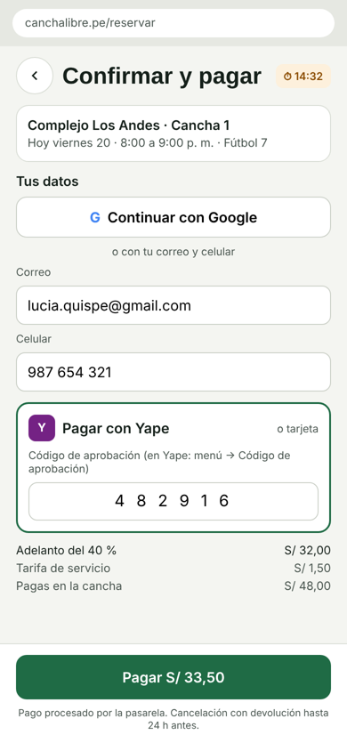
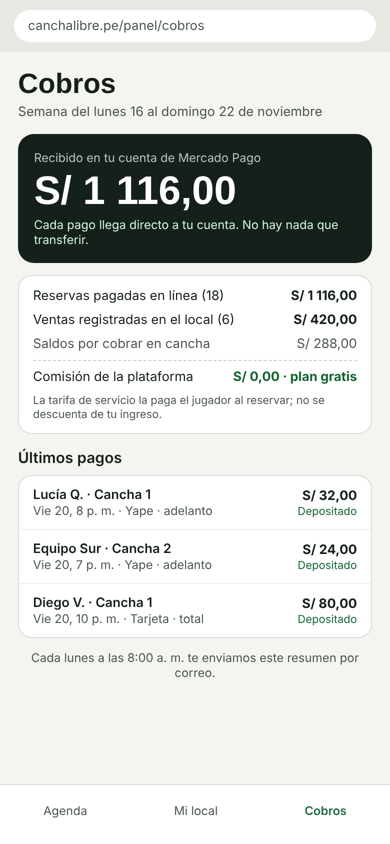

# Avance del proyecto

Este archivo une el **diseño** de las pantallas con el **código** del repositorio.
Sirve para ver desde cualquier lugar qué se avanzó, qué falta y qué se puede mejorar.

- Diseño inicial (prototipo navegable): https://claude.ai/artifact/97fFTfsrfF3E3vEDqQy5vu
- Diseño elegido para el código ("Noche de estadio"): `docs/diseno/`
- Repositorio: https://github.com/020200141d-coder/TukanchitaP

**Cómo actualizarlo:** cuando alguien termine una parte, cambia su estado aquí y lo sube en el mismo commit que el código.

| Símbolo | Significa |
|:---:|---|
| ✅ | Terminado |
| 🔨 | En progreso |
| ⬜ | Pendiente |

_Última revisión: 27 de noviembre de 2026._

---

## Resumen

| Parte | Estado | Comentario |
|---|:---:|---|
| Propuesta del proyecto | ✅ | `docs/Propuesta_Proyecto.docx` |
| Hito 1: requerimientos, modelo, diagramas, repositorio | ✅ | `docs/Hito1_Evidencias.docx` |
| Hito 2: API REST y base de datos | ✅ | `docs/Hito2_API_Base_de_Datos.docx` |
| Sesión 3: configuración del backend | ✅ | `docs/Sesion3_Configuracion_Backend.docx` (APA 7, 15 capturas) |
| Diseño de pantallas | ✅ | Prototipo inicial (8 pantallas) y diseño final "Noche de estadio" |
| Base de datos (Prisma + PostgreSQL) | ✅ | Esquema, 3 migraciones y semilla con 5 canchitas de Cusco |
| Backend (API REST) | ✅ | Express 5 con estructura modular (`src/modules/`), módulos ES y nodemon; JWT, roles, Zod y Swagger en `/docs` |
| Frontend (React) | ✅ | Inicio con mapa, ficha de cancha, reservas, panel del dueño y panel admin |
| Pagos | ✅ | Yape/Plin con foto del comprobante y aprobación del dueño |
| Pruebas | ✅ | 95 pruebas de Jest + Supertest aprobadas; colección de Postman |
| Integración continua | ✅ | GitHub Actions corre las pruebas en cada push |
| Despliegue en Render + Supabase | 🔨 | `render.yaml` y guía listos; falta crear los servicios y publicar |
| Datos reales de las canchas | 🔨 | Coordenadas, precios y horarios por confirmar con cada dueño |
| Integrantes en README y documentos | ✅ | Los 4 integrantes con sus módulos |

---

## Pantallas: diseño inicial → código

Cada pantalla del prototipo inicial y dónde quedó en la aplicación.

### Recorrido del jugador

| Diseño | Qué hace | En el código |
|:---:|---|---|
|  | **Inicio con el mapa.** Canchas cercanas con precio. | ✅ `paginas/Inicio.jsx`: portada, buscador, filtros, "cerca de mí", tarjetas con horas libres de hoy y mapa. |
|  | **Página del local.** Elegir día y hora libre. | ✅ `paginas/Cancha.jsx`: horas libres por día con precio, tarifas, reseñas, "Cómo llegar" y WhatsApp del dueño. |
|  | **Datos y pago.** La hora se separa 15 minutos. | ✅ Separación de 15 min y pago del adelanto por Yape/Plin subiendo el comprobante (`util/reservar.js`, `MisReservas.jsx`). |
|  | **Reserva confirmada.** Código y compartir con el equipo. | ✅ Alerta de confirmación con confeti y botón "Avisar al equipo" por WhatsApp. |

### Recorrido del vendedor (dueño)

| Diseño | Qué hace | En el código |
|:---:|---|---|
|  | **Ingreso.** Jugador o dueño; correo o Google. | ✅ `paginas/Acceso.jsx`: ingresar y crear cuenta con correo. ⬜ Ingreso con Google (en la hoja de ruta). |
|  | **Panel del vendedor.** Agenda del día y ventas en el local. | ✅ `paginas/PanelDueno.jsx`: mis canchas, calendario semanal, pagos, tarifas y bloqueos. ⬜ Indicador "En línea". |
|  | **Registro del local.** Ubicación por GPS y fotos. | ✅ `componentes/FormCancha.jsx`: ubicación en el mapa con búsqueda de dirección, fotos y QR de Yape/Plin. ⬜ Verificación con GPS a 50 m. |
|  | **Cobros de la semana.** Lo recibido y los saldos. | 🔨 Pestaña "Pagos" para aprobar comprobantes. Falta el resumen semanal de ingresos. |

### Pantallas que se agregaron en el código

| Pantalla | Para qué | Estado |
|---|---|:---:|
| Mis reservas (jugador) | Estado, cuenta regresiva para pagar, cancelación y reseña | ✅ |
| Panel del administrador | Resumen, usuarios, canchas, reservas, pagos, reseñas, anuncios e imágenes del sitio | ✅ |

---

## Cambios respecto del Hito 1 (y por qué)

| Antes (Hito 1) | Ahora (código) | Motivo |
|---|---|---|
| Pago con Mercado Pago en modo de prueba | Yape/Plin manual con comprobante | Costo cero y es lo que usan los locales de Cusco |
| Nombre de trabajo "Cancha Libre" | **tukanchitape** | Nombre elegido por el equipo |
| Rol "VENDEDOR" | Rol "DUENO" | Más claro para el usuario |
| Ubicación solo por GPS a 50 m | Pin en el mapa con búsqueda de dirección | Más fácil para el dueño; la verificación queda como mejora |
| Avisos automáticos | Enlaces de WhatsApp con el texto listo | Sin costo por mensaje |

Estos cambios deben mencionarse en el siguiente informe como cambios justificados.

---

## Backend por módulo

Cada módulo vive en `backend/src/modules/<módulo>/` con sus archivos `*.routes.js`, `*.controller.js`, `*.service.js` y `*.schema.js`, como pide la guía de la sesión 3.

| Módulo | Responsable | Rutas | Servicio | Pruebas |
|---|---|:---:|:---:|:---:|
| `auth` (usuarios y autenticación) | Aguirre Bravo, Edson Francisco Lino | ✅ | ✅ | ✅ |
| `canchas` | Aguirre Bravo, Edson Francisco Lino | ✅ | ✅ | ✅ |
| `reservas` | Canal Sayago, Pabel Junior | ✅ | ✅ | ✅ |
| `horarios` (tarifas, bloqueos, horas libres) | Canal Sayago, Pabel Junior | ✅ | ✅ | ✅ |
| `pagos` (Yape/Plin y reseñas) | Carpio Letona, Rfit Holger | ✅ | ✅ | ✅ |
| `admin`, `anuncios` e `imagenes` | Carpio Letona, Rfit Holger | ✅ | ✅ | ✅ |
| Frontend React y pruebas | Paredes Claros, Adrian Mauricio | ✅ | — | ✅ |
| Despliegue (Render + Supabase) | Aguirre Bravo, Edson Francisco Lino | 🔨 | — | — |

---

## Qué podemos mejorar

| Mejora | Prioridad | Comentario |
|---|:---:|---|
| Publicar en Render + Supabase | Alta | Sin esto no hay enlace para mostrar fuera de la PC |
| Confirmar datos de las 5 canchas reales | Alta | Precios, horarios y ubicación con cada dueño |
| Resumen semanal de ingresos del dueño | Media | Era la pantalla "Cobros" del diseño |
| Ingreso con Google | Media | Estaba en el Hito 1 |
| Indicador "En línea" del dueño | Media | Estaba en el diseño inicial |
| App instalable (PWA) y avisos push | Baja | En la hoja de ruta del README |
| "Arma tu pichanga" y turnos fijos semanales | Baja | Ideas para atraer más jugadores |

### Puntos en discusión

| Tema | Situación |
|---|---|
| Días para reservar con anticipación | El código usa 30 (`DIAS_ANTICIPACION`); el equipo hablaba de 10 a 14 |
| Porcentaje de adelanto | El código usa 30 % (`PORCENTAJE_ADELANTO`); el Hito 1 decía 40 % |
| Horas para cancelar sin perder el adelanto | El código usa 6 (`HORAS_CANCELACION`); el Hito 1 decía 24 |

Estos valores se cambian en el `.env` sin tocar código, pero conviene decidirlos y que el informe diga lo mismo.

---

## Registro de avances

| Fecha | Qué se hizo | Quién |
|---|---|---|
| 2026-11-20 | Propuesta del proyecto y diseño de 8 pantallas | Edson |
| 2026-11-25 | Hito 1: requerimientos, modelo de datos, diagramas y repositorio inicial | Edson |
| 2026-11-27 | Backend completo (etapas 1 a 6), pruebas, frontend, diseño "Noche de estadio" y preparación del despliegue | Edson |
| 2026-11-27 | Este archivo actualizado con el estado real del código | Edson |
| 2026-11-27 | Informe del Hito 2 (API REST y base de datos) en APA 7 | Edson |
| 2026-11-27 | Backend reorganizado en módulos como la guía de la sesión 3 (módulos ES y nodemon); informe de la sesión 3 en APA 7 con capturas; repositorio renombrado a TukanchitaP | Edson |
