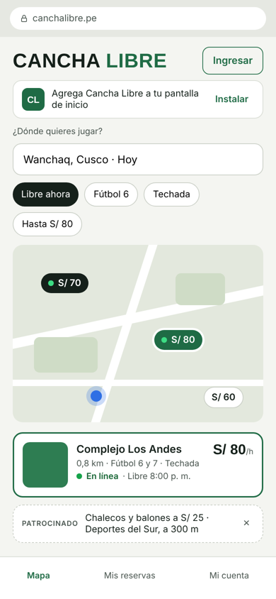
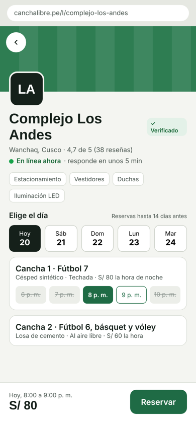
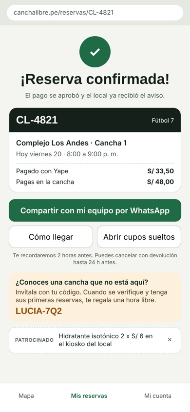
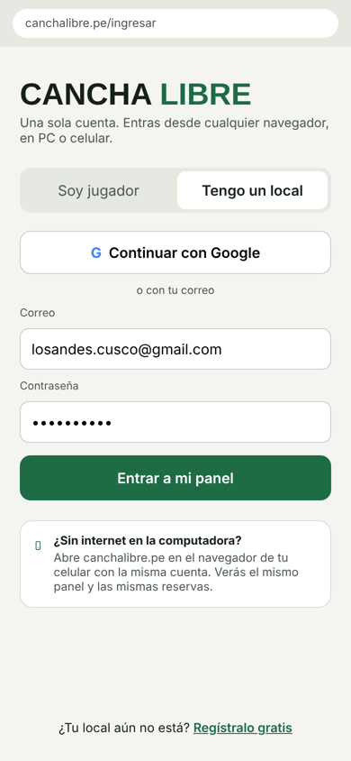
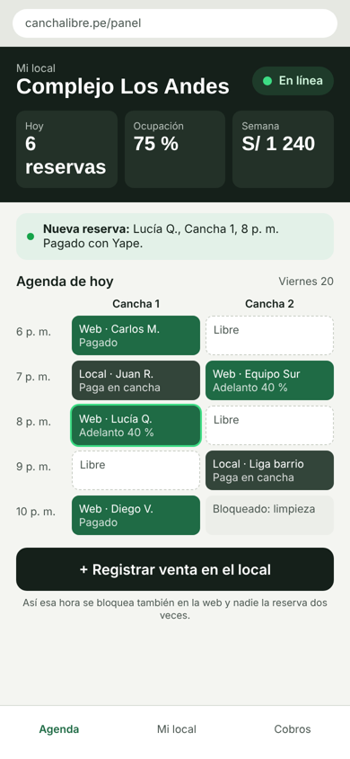
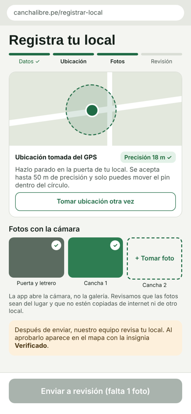

# Avance del proyecto

Este archivo une el **diseño** de las pantallas con el **código** del repositorio.
Sirve para ver desde cualquier lugar qué se avanzó, qué falta y qué se puede mejorar.

- Diseño completo (prototipo navegable): https://claude.ai/artifact/97fFTfsrfF3E3vEDqQy5vu
- Repositorio: https://github.com/020200141d-coder/Tuchanchitap

**Cómo actualizarlo:** cuando alguien termine una parte, cambia su estado en las tablas de abajo y lo sube en el mismo commit que el código.

| Símbolo | Significa |
|:---:|---|
| ✅ | Terminado |
| 🔨 | En progreso |
| ⬜ | Pendiente |

---

## Resumen

| Parte | Estado | Comentario |
|---|:---:|---|
| Propuesta del proyecto | ✅ | `docs/Propuesta_Proyecto.docx` |
| Hito 1: requerimientos, modelo, diagramas, repositorio | ✅ | `docs/Hito1_Evidencias.docx` |
| Diseño de las 8 pantallas | ✅ | Ver abajo |
| Base de datos (Prisma) | 🔨 | Esquema escrito; falta crear la base en Supabase y migrar |
| Backend (API) | 🔨 | Estructura por capas lista; endpoints pendientes |
| Frontend (React) | 🔨 | Proyecto creado; pantallas pendientes |
| Pagos (Mercado Pago en modo de prueba) | ⬜ | |
| Pruebas | ⬜ | |
| Despliegue en Render | ⬜ | |

---

## Pantallas: diseño → código

Cada pantalla indica en qué archivo se programa, qué endpoints de la API necesita y su estado.

### Recorrido del jugador

| Diseño | Qué hace | Código |
|:---:|---|---|
|  | **Inicio con el mapa.** Locales cercanos con precio y si el vendedor está en línea. RF10 | Pantalla: `frontend/src/pages/Inicio.jsx` ⬜ API: `GET /api/locales?lat&lng&distrito` ⬜ |
|  | **Página del local.** Elegir día, cancha y hora; las horas ocupadas salen tachadas. RF11 | Pantalla: `frontend/src/pages/Local.jsx` ⬜ API: `GET /api/locales/:id` ⬜ `GET /api/reservas/disponibilidad?cancha&fecha` ⬜ |
|  | **Datos y pago.** Pago con Yape o tarjeta; la hora se separa 15 min. RF12, RF16 | Pantalla: `frontend/src/pages/Reservar.jsx` ⬜ API: `POST /api/reservas` ⬜ `POST /api/pagos` ⬜ |
|  | **Reserva confirmada.** Código de reserva y opción de compartir. RF17 | Pantalla: `frontend/src/pages/Confirmada.jsx` ⬜ API: `POST /api/pagos/webhook` ⬜ |

### Recorrido del vendedor

| Diseño | Qué hace | Código |
|:---:|---|---|
|  | **Ingreso.** "Soy jugador" o "Tengo un local"; correo o Google. RF01, RF02 | Pantalla: `frontend/src/pages/Ingresar.jsx` ⬜ API: `POST /api/usuarios/registro` ⬜ `POST /api/usuarios/login` ⬜ |
|  | **Panel del vendedor.** En línea, agenda del día y registrar venta en el local. RF14, RF20 | Pantalla: `frontend/src/pages/Panel.jsx` ⬜ API: `GET /api/reportes/agenda?fecha` ⬜ `POST /api/reservas/local` ⬜ |
|  | **Registro del local.** Ubicación por GPS (hasta 50 m) y fotos con la cámara. RF05 | Pantalla: `frontend/src/pages/RegistrarLocal.jsx` ⬜ API: `POST /api/locales` ⬜ `POST /api/locales/:id/fotos` ⬜ |
|  | **Cobros de la semana.** Lo recibido, saldos por cobrar y últimos pagos. RF19, RF21 | Pantalla: `frontend/src/pages/Cobros.jsx` ⬜ API: `GET /api/reportes/cobros?desde&hasta` ⬜ |

### Pantallas que faltan diseñar

| Pantalla | Para qué | Estado |
|---|---|:---:|
| Panel del administrador | Aprobar locales y gestionar usuarios (RF04, RF06) | ⬜ |
| Mis reservas (jugador) | Historial y cancelación (RF15, RF18) | ⬜ |
| Canchas y tarifas (vendedor) | Crear canchas, horarios, tarifas y bloqueos (RF07–RF09) | ⬜ |

---

## Backend por módulo

| Módulo | Responsable | Rutas | Servicio | Repositorio | Pruebas |
|---|---|:---:|:---:|:---:|:---:|
| Usuarios y autenticación | Edson | ⬜ | ⬜ | ⬜ | ⬜ |
| Locales y canchas | Edson | ⬜ | ⬜ | ⬜ | ⬜ |
| Reservas | Estudiante 2 | ⬜ | ⬜ | ⬜ | ⬜ |
| Pagos | Estudiante 3 | ⬜ | ⬜ | ⬜ | ⬜ |
| Reportes | Estudiante 3 | ⬜ | ⬜ | ⬜ | ⬜ |

Ya hecho en el backend: `app.js`, `server.js`, middlewares (`auth`, `roles`, `validar`, `errores`), `schema.prisma` y el SQL que evita reservas cruzadas.

---

## Puntos en discusión y mejoras

| Tema | Situación | Decisión |
|---|---|---|
| Días para reservar con anticipación | Entre 10 y 14; el diseño muestra 14 | Pendiente |
| Cobro de la plataforma | Tarifa de servicio al jugador; plan gratis al vendedor | Pendiente de mejorar |
| Nombre definitivo | Repositorio "Tuchanchitap"; el diseño usa "Cancha Libre" | Pendiente |
| Avisos por WhatsApp | Tiene costo por mensaje | Fuera de la primera versión |
| Pantallas del administrador, de "Mis reservas" y de canchas y tarifas | No están en el diseño | Diseñar antes del Hito 3 |

---

## Registro de avances

| Fecha | Qué se hizo | Quién |
|---|---|---|
| 2026-11-20 | Propuesta del proyecto y diseño de 8 pantallas | Edson |
| 2026-11-25 | Hito 1: requerimientos, modelo de datos, diagramas y repositorio inicial | Edson |
| 2026-11-27 | Este archivo de avance, que une el diseño con el código | Edson |
